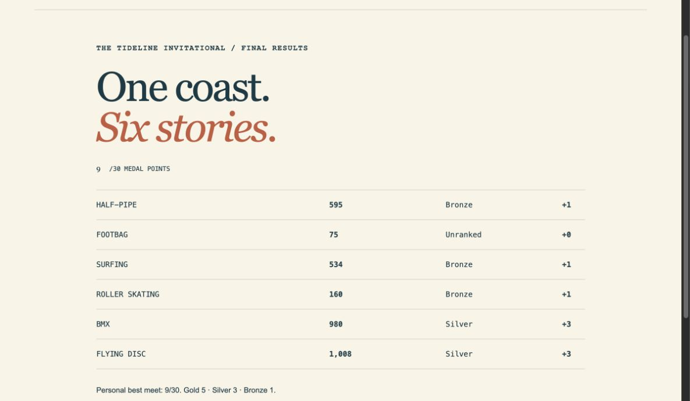

# Tideline Six

An original browser sports meet inspired by the event variety, cameras, and input rhythms of **California Games**. Skate a concrete crescent, juggle a footbag, carve a wave, stride along a promenade, flip a BMX bike, then throw and catch a flying disc. All six events are implemented with distinct rules, controls, scoring, failure states, and results.



## Play locally

Requires Node.js 22.12+ (Node 24 recommended).

```sh
npm ci
npm run dev
```

Open **http://127.0.0.1:5225**. For the production build:

```sh
npm run build
npm run preview
```

Practice any event from the home cards. The six-event meet plays every sport in sequence and awards medals against visible targets: bronze = 1, silver = 3, gold = 5. Maximum meet score: 30. Records update only in competition and persist per browser under `tideline-six:v1`. Reset affects only this game's records. No account, analytics, network assets, or server save service.

## Controls

| Sport | Controls |
| --- | --- |
| Half-pipe | ↑ uphill / ↓ downhill to pump; Space near lip for kick turn, above lip at speed for aerial; hold X at lip then release after 0.2–0.7s for handplant |
| Footbag | ← → move; Space kicks descending bag near feet; ↑ headers near head; ↓ turns while bag is high, then complete next contact for bonus |
| Surfing | ← → rotate board; hold Space for sharper turns; cross top lip then turn downhill before landing |
| Roller skating | Alternate ↑ ↓ to stride; ← → lanes; hold Space to squat under balls, release to jump cracks/cones |
| BMX | Tap → to pedal; ← brake; Space hop; ramps launch automatically; ↑ / ↓ rotate in air, release when wheels are level |
| Flying disc | Space starts backswing; Space in green sets power; Space in green releases; ← → move catcher; ↑ overhead catch or Space dive when disc is close |

Enter starts a briefing. P pauses/resumes. Esc returns home. Touch controls support held and simultaneous inputs. Sound starts off and can be toggled. The game pauses when the window loses focus or the tab is hidden.

## Scope and research

This is a compact interpretation, not an emulator or a claim of exact fidelity. It uses shorter 35–40 second rounds (disc up to 60s), simplified trick catalogs and physics, single player, and fixed medal targets. No licensed sponsors, copied characters/art/music, multiplayer, serious-injury BMX rules, complete footbag catalog, skating spins, running-disc catch variants, or exact judge algorithms. See [source research, platform differences and event-by-event omissions](docs/RESEARCH.md), [specification](docs/SPEC.md), and [domain glossary](CONTEXT.md).

The computer six-event lineup is the baseline; the Lynx has four events with different controls, time limits and scoring. Art is generated by original Canvas drawing code; optional sound is original Web Audio oscillator feedback. No external assets are loaded.

## Validation

```sh
npm test                 # deterministic sport, lifecycle, meet and storage tests
npm run build           # strict TypeScript plus production build
npx playwright install chromium
npm run test:browser     # isolated headless Chromium, normal UI inputs
```

Tests do not operate an existing browser profile. See [verification notes](docs/VERIFICATION.md) for native coverage, independent reviews, and evidence limitations. CI runs the same checks on pushed commits. No GitHub Pages or public website deployment is configured.

## Engineering

Sport state is separate from drawing and advances at 60 fixed steps/second. Input distinguishes presses, held keys, and releases. UI owns session and pause state; the meet prevents duplicate/out-of-order result submissions. Stored records are versioned and validated, with graceful storage denial. Unrelated origin data is never enumerated or cleared.

The project follows the local Matt Pocock Grill with Docs/domain-modeling and Implement workflows, with the requested recommended defaults replacing optional interviewing. Independent standards and fidelity reviews are recorded in verification notes.

## License and ignores

Original source, artwork code and generated audio: [MIT](LICENSE). California Games and its associated properties belong to their respective owners; this project is unaffiliated.

`.gitignore` contains the official GitHub Global templates [Linux](https://github.com/github/gitignore/blob/main/Global/Linux.gitignore), [Windows](https://github.com/github/gitignore/blob/main/Global/Windows.gitignore), and [macOS](https://github.com/github/gitignore/blob/main/Global/macOS.gitignore), followed by project-specific ignores for dependencies, builds, local output, reports, environment files and logs.
